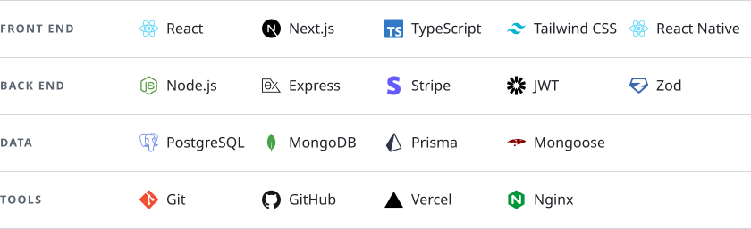

# Abdul Rehman

📍 Punjab, Pakistan · Full-stack developer · 🟢 Open to work and collaboration

I build full-stack web applications with a focus on thoughtful architecture, reliable functionality and maintainable code. I care about how software works beneath the interface as much as how it feels to use, from well-structured data flows to the decisions that keep applications dependable as they grow.

## Stack

<picture>
  <source media="(prefers-color-scheme: dark)" srcset="assets/stack-dark.svg">
  
</picture>

## Moving toward

I'm expanding my full-stack experience into DevOps and Cloud Infrastructure, with a focus on understanding how applications run, scale, and stay reliable in production. What I'm building toward:

- **Linux and Docker:** containerised deploys, and infrastructure you can version and reproduce
- **CI/CD:** pipelines that test, build and ship on every push
- **Cloud platforms and infrastructure automation:** systems that scale and stay reliable

The goal: understand the entire lifecycle of a software product, from writing code to deploying, monitoring, and maintaining the systems behind it.

## Find me

  <a href="https://www.linkedin.com/in/heyrehmandev"><picture><source media="(prefers-color-scheme: dark)" srcset="assets/link-linkedin-dark.svg"></picture></a>&nbsp;
  <a href="mailto:abdulrahman.ar07x@gmail.com"><picture><source media="(prefers-color-scheme: dark)" srcset="assets/link-email-dark.svg"></picture></a>&nbsp;
  <a href="https://www.heyrehman.dev"><picture><source media="(prefers-color-scheme: dark)" srcset="assets/link-portfolio-dark.svg"></picture></a>

